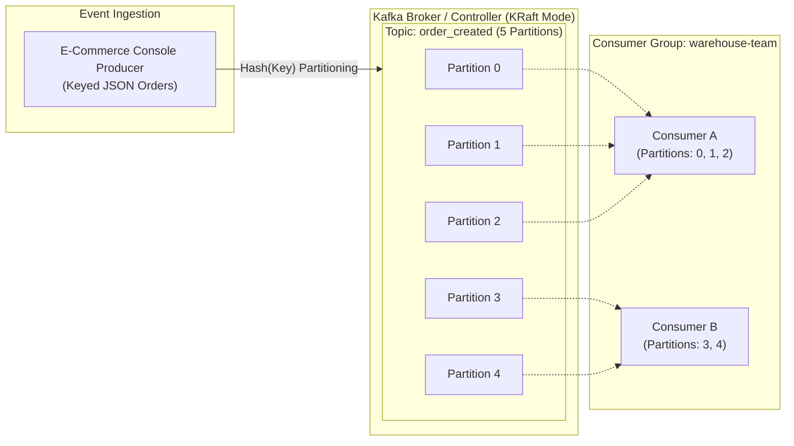

# 🛒 Real-Time E-Commerce Event Streaming Platform with Apache Kafka (KRaft Mode)

[](https://kafka.apache.org/)
[](https://www.docker.com/)
[-green.svg)](#kraft-architecture)
[](#key-learnings--engineering-insights)

An end-to-end hands-on project demonstrating production-grade event streaming, distributed data processing, dynamic scaling, and consumer group coordination for an e-commerce platform using **Apache Kafka 4.0.1** running in **KRaft** mode (Kafka Raft Metadata mode without ZooKeeper).

---

## 📌 Architecture Overview



### Key Architectural Highlights:
* **KRaft Mode (No ZooKeeper):** Uses Kafka's modern consensus protocol where node `1` acts as both the **broker** and the **controller quorum voter**, significantly reducing operational complexity and latency.
* **Key-Based Partitioning:** Order events are routed deterministically via message keys (`key:value`), ensuring strict in-order delivery per entity while spreading load horizontally across partitions.
* **Consumer Groups & Parallelism:** Demonstrates dynamic partition rebalancing, fault-tolerant failovers, and workload distribution across multiple instances within the `warehouse-team` consumer group.
* **Zero-Downtime Administration:** Dynamic configuration alterations (`retention.ms`) and partition scaling ($3 \to 5$) applied on the live broker with zero disruption to active producers.

---

## 🛠️ Project Structure

```text
kafka-ecommerce-streaming-platform/
├── docker-compose.yml       # Single-node KRaft Apache Kafka 4.0.1 configuration
├── .gitignore               # Ignored build & system artifacts
├── README.md                # Project documentation & walkthrough
└── assets/             # Execution verification and output logs
    ├── 01-docker-cluster-status.png
    ├── 02-topic-scaling-retention.png
    ├── 03-consumer-groups-load-balancing.png
    └── 04-consumer-lag-monitoring.png
```

---

## 🚀 Lab Walkthrough & Step-by-Step Execution

### Prerequisite: Spin up the KRaft Cluster
Deploy the containerized single-broker KRaft cluster using Docker Compose:

```powershell
docker compose up -d
docker compose ps
```

* **Image:** `apache/kafka:4.0.1`
* **Container Name:** `gaming-kafka`
* **Healthcheck:** Verified via `kafka-broker-api-versions.sh` on `localhost:9092` until status transitions to `(healthy)`.

---

### Step 1: Infrastructure Provisioning (Topic Management)
Create the core e-commerce topic `order_created` with 3 initial partitions and a replication factor of 1:

```powershell
docker exec -it gaming-kafka /opt/kafka/bin/kafka-topics.sh `
  --bootstrap-server localhost:9092 `
  --create --topic order_created `
  --partitions 3 --replication-factor 1
```

Verify topic metadata and broker assignment:
```powershell
docker exec -it gaming-kafka /opt/kafka/bin/kafka-topics.sh `
  --bootstrap-server localhost:9092 `
  --describe --topic order_created
```

---

### Step 2 & 3: Real-Time Event Ingestion & Consumption
Simulate upstream order events using the Kafka console producer:

```powershell
docker exec -it gaming-kafka /opt/kafka/bin/kafka-console-producer.sh `
  --bootstrap-server localhost:9092 `
  --topic order_created
```

Sample JSON payload:
```json
{"id":1, "user":"Mariam", "item":"Laptop"}
{"id":2, "user":"Ali", "item":"Mouse"}
{"id":3, "user":"Zaid", "item":"Monitor"}
```

In parallel, launch a consumer stream reading from the earliest available offset:
```powershell
docker exec -it gaming-kafka /opt/kafka/bin/kafka-console-consumer.sh `
  --bootstrap-server localhost:9092 `
  --topic order_created --from-beginning
```
New orders sent to the producer stream immediately to the consumer in real time with millisecond latency.

---

### Step 4: Zero-Downtime Dynamic Reconfiguration & Partition Scaling
Kafka allows dynamic runtime configuration without requiring cluster restarts:

1. **Alter Retention Period:** Set topic-level message retention to 8 hours ($28,800,000 \text{ ms}$):
   ```powershell
   docker exec -it gaming-kafka /opt/kafka/bin/kafka-configs.sh `
     --bootstrap-server localhost:9092 `
     --alter --entity-type topics --entity-name order_created `
     --add-config retention.ms=28800000
   ```

2. **Horizontal Scaling:** Scale partitions from 3 to 5:
   ```powershell
   docker exec -it gaming-kafka /opt/kafka/bin/kafka-topics.sh `
     --bootstrap-server localhost:9092 `
     --alter --topic order_created --partitions 5
   ```

3. **Verification:**
   ```powershell
   docker exec -it gaming-kafka /opt/kafka/bin/kafka-topics.sh `
     --bootstrap-server localhost:9092 `
     --describe --topic order_created
   ```


---

### Step 5: Consumer Groups, Load Balancing & Failover
Deploy multiple consumers under the same group `warehouse-team` to achieve parallel consumption and automatic partition rebalancing.

1. **Launch Consumer A and Consumer B:**
   ```powershell
   # Run in Terminal Consumer A & Consumer B
   docker exec -it gaming-kafka /opt/kafka/bin/kafka-console-consumer.sh `
     --bootstrap-server localhost:9092 `
     --topic order_created --group warehouse-team
   ```

2. **Send Keyed Orders via Producer:**
   Restart producer with key parsing enabled (`key:value` syntax):
   ```powershell
   docker exec -it gaming-kafka /opt/kafka/bin/kafka-console-producer.sh `
     --bootstrap-server localhost:9092 `
     --topic order_created `
     --property parse.key=true --property key.separator=:
   ```
   Produce orders with unique keys:
   ```text
   5:{"id":5, "user":"Laila", "item":"Tablet"}
   6:{"id":6, "user":"Kareem", "item":"Smartwatch"}
   7:{"id":7, "user":"Sara", "item":"Camera"}
   8:{"id":8, "user":"Hassan", "item":"Speaker"}
   9:{"id":9, "user":"Mona", "item":"Printer"}
   10:{"id":10, "user":"Tarek", "item":"Router"}
   ```

3. **Verify Load Balancing & Failover:**
   * Orders are split evenly between Consumer A and Consumer B with zero duplicate deliveries.
   * Upon gracefully shutting down Consumer B (`Ctrl+C`), Kafka initiates a **Rebalance Protocol**, assigning all 5 partitions to Consumer A without dropping any incoming messages.


---

### Step 6: Cluster Health, Consumer Offset & Lag Monitoring
Monitoring consumer group lag is critical for detecting pipeline backpressure and consumer bottlenecks.

$$\text{LAG} = \text{LOG-END-OFFSET} - \text{CURRENT-OFFSET}$$

1. **Simulate Consumer Failure:** Stop all active consumers in `warehouse-team`.
2. **Ingest New Orders:** Send new orders while consumers are offline.
3. **Inspect Consumer Lag:**
   ```powershell
   docker exec -it gaming-kafka /opt/kafka/bin/kafka-consumer-groups.sh `
     --bootstrap-server localhost:9092 `
     --describe --group warehouse-team
   ```

Notice how `LAG` elevates to `1` across receiving partitions, with Kafka retaining unconsumed messages safely on disk:


4. **Consumer Recovery:** Re-launching Consumer A immediately reads only the uncommitted messages, swiftly restoring `LAG` to `0` across all partitions.

---

### Step 7: Teardown & Clean Reset
```powershell
# 1. Delete topic
docker exec -it gaming-kafka /opt/kafka/bin/kafka-topics.sh `
  --bootstrap-server localhost:9092 --delete --topic order_created

# 2. Stop container and destroy storage volume
docker compose down -v
```

---

## 🧠 Key Learnings & Engineering Insights

| Concept | Production Reality & Takeaway |
| :--- | :--- |
| **Ordering Guarantee** | Kafka guarantees message ordering **strictly per partition**, not globally across the entire topic. Entities requiring ordered processing (e.g., state updates for a specific user or order) must use the same partition key. |
| **Partition Rebalance** | Consumer group membership changes trigger cooperative rebalancing, distributing topic partitions dynamically among active instances. |
| **Dynamic Configuration** | Production topics can scale partitions and modify data retention SLAs on live systems with zero broker downtime. |
| **Offset & Lag Management** | Offsets represent durable consumer progress committed to the internal `__consumer_offsets` topic. Monitoring lag prevents data stalls and informs auto-scaling decisions. |

---

## 👤 Author
* **Engineer:** Sabry Mahmoud
* **Technologies:** Apache Kafka 4.0.1, Docker, Linux/PowerShell, Event-Driven Architecture
